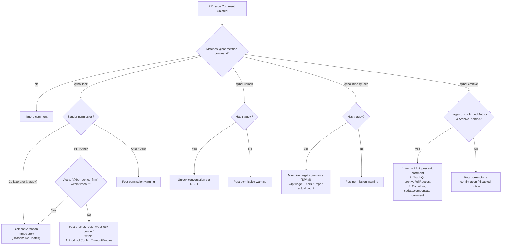

# Conversation Guard & Moderation Module

Provides pull request conversation locking, comment spam suppression, PR archiving commands, and automated locking of inactive closed pull requests.

---

## 1. Purpose and Trigger Events

High-profile or contentious package changes can attract heated discussions, post-closure harassment, or spam comments. `ConversationGuardModule` (Priority: 95) empowers PR authors and maintainers to control discussion state using `@<bot>` mention commands. In addition, `LockSweepService` scans closed pull requests and automatically locks discussions after an extended period of inactivity.

### Trigger Events
- `issue_comment` (`created`) on **Pull Requests only** (plain repository issues are ignored by the webhook processor)
- Periodic background timer (`LockSweepService`, default every 12 hours)

---

## 2. Mention Commands, Authorization, and Moderation Workflow

When `ConversationGuard:Enabled` is `true`, maintainer authority is verified against **GitHub's authoritative repository collaborator permissions** (`triage`, `write`, `maintain`, or `admin` via `IRepositoryPermissionService`). This accurately handles first-time contributors, external collaborators without organization membership, and read-only organization members.

> [!IMPORTANT]
> Enabling `ConversationGuard` uses GitHub's collaborator permission endpoint, which on GitHub App installations requires mandatory **`Metadata: Read-only`** (no `Administration` or `Contents: Read & write` permission is needed solely for collaborator lookups); when `PackageUpdate:BotPat` is configured, **all** API calls switch globally to that PAT user, so the PAT must hold the complete superset required by active modules: **`push+`** repository access (required for `ConversationGuard` or live `PackageUpdate` with `DryRun=false`) alongside **`Contents: write`**, **`Issues: write`**, **`Pull requests: write`**, **`Actions: read`**, and classic **`read:org`** / **`Organization -> Members: Read-only`** (`ConversationGuardPermissionProbe` verifies collaborator `push+` and archive `triage+`; `PackageUpdatePermissionProbe` verifies organization team-read once per unique organization whenever `BotPat` and `GitHubApp:TeamName` are configured and verifies `push+` + `Actions: Read-only` when `PackageUpdate:Enabled=true && DryRun=false`; GitHub REST exposes no non-mutating write-scope introspection for fine-grained PAT `Contents`/`Issues`/`Pull requests` grants—see [docs/deployment.md](../deployment.md)).
> Enabling `ConversationGuard:ArchiveEnabled` (`@<bot> archive`) alongside `ConversationGuard:Enabled=true` requires configuring `PackageUpdate:BotPat`, because GitHub's `archivePullRequest` GraphQL mutation requires a user role (`triage` or higher) and always returns `FORBIDDEN` for GitHub App installation tokens even when **Administration: Read & write** is granted; although `VerifyArchivePermissionProbeAsync` checks `triage`+, combining `ArchiveEnabled=true` with `ConversationGuard:Enabled=true` means the shared PAT must hold **`push+`** plus the full global PAT scope set above. Once archived, a pull request becomes **strictly read-only** (GitHub rejects all new comments, including from maintainers and admins, with HTTP 403), so restoring an archived pull request must be performed out-of-band via the GitHub Web UI ("Unarchive pull request") or `gh api graphql`. When `Enabled=true && ArchiveEnabled=true`, both startup configuration validation (`ValidateOnStart`) and `ConversationGuardPermissionProbe` fail fast at startup (before webhook dispatch or `LockSweepService` runs) if `PackageUpdate:BotPat` is absent or lacks required permissions (`VerifyCollaboratorPermissionProbeAsync` rejects `triage`-only PATs when repository permissions indicate no `push`+ role, though if GitHub omits `Repository.Permissions` (`null`) it proceeds to probe `ReviewPermission` while `VerifyArchivePermissionProbeAsync` fails fast whenever `Permissions` is `null` or below `triage`). When `ConversationGuard:Enabled=false`, `ConversationGuard` validation/probing remains inactive. Leave `ConversationGuard:ArchiveEnabled=false` for GitHub App-only deployments.



### Supported Mention Commands

All commands address the bot using its live GitHub handle (resolved automatically from GitHub API via `BotPat` or GitHub App slug, e.g., `@abaci-bot`).

| Command | Allowed Callers | Confirmation / Behavior |
|---|---|---|
| `@<bot> lock` | Collaborators (`triage`+), PR Author | Collaborators (`triage`+) lock immediately. Non-privileged PR authors receive a prompt requiring `@<bot> lock confirm` (or `@<bot> lock yes`) within `AuthorLockConfirmTimeoutMinutes`. Checks `IsIssueLockedAsync` first, posts the lock announcement **before** locking (since locked issues reject App comments with 403), and locks with reason `TooHeated`. |
| `@<bot> lock confirm` | PR Author, Collaborators (`triage`+) | Atomically completes author self-lock if an active request exists within the TTL window; otherwise starts a new confirmation window. |
| `@<bot> unlock` | Collaborators (`triage`+) only | Checks `IsIssueLockedAsync` first; when locked, unlocks the conversation via REST `UnlockIssueAsync` without calling `UnarchivePullRequestAsync`, and posts the unlock notice via HTTP 403-resilient `TryPostReplyAsync`. When not locked, replies that the conversation is not locked. |
| `@<bot> hide @username` | Collaborators (`triage`+) only | Parses target handle with trailing punctuation tolerance (including spaces, `:`, `,`, `.`, `!`, `?`, `;`, `)`, `]`, and ASCII/smart quotes), matching exact username first and falling back one-way to `@username[bot]` only when zero exact matches exist and the input omits `[bot]` (never strips `[bot]` to match a human user). Folds all matched comments using GitHub GraphQL `minimizeComment(classifier: SPAM)`. Never deletes comments. Protects comments authored by users with `triage`+ repository access (on both exact and `[bot]`-resolved targets, failing closed with an explicit permission-lookup failure reply on API error rather than hiding or misreporting a maintainer); all status/error/summary replies handle HTTP 403 on locked/archived PRs gracefully without crashing the pipeline. |
| `@<bot> archive` | Collaborators (`triage`+), PR Author | Archives the pull request via GraphQL `archivePullRequest`. Requires `ArchiveEnabled == true` **and** `PackageUpdate:BotPat` (while `archivePullRequest` checks `triage`+, enabling `ConversationGuard:Enabled=true` routes collaborator probing through the global PAT and therefore requires **`push+`** access alongside the global PAT scopes in the note above—`Contents: write`, `Issues: write`, `Pull requests: write`, `Actions: read`, and `Organization Members: read` / classic `read:org`, where `push+`/`triage+` and org team-read are probed on startup while fine-grained write scopes other than live `PackageUpdate` `Actions` read are validated by GitHub on write; GitHub App installation tokens cannot archive pull requests even with `Administration: Read & write`). Non-privileged PR authors must confirm via `@<bot> archive confirm` within `AuthorLockConfirmTimeoutMinutes`. Posts a tracked exit comment before archiving (returning cleanly on 403 if already locked/archived), and updates that exit comment in-place via `UpdateCommentAsync` on failure (falling back to a compensation comment only if tracked ID is unavailable or update fails). Archived PRs reject all new comments with HTTP 403, so unarchiving is out-of-band only (GitHub Web UI or `gh api graphql`). |

---

## 3. Inactive Pull Request Locking

`LockSweepService` runs periodically (default every 12 hours) to lock abandoned closed pull requests:
- Evaluates `closed_at` timestamps using paginated GitHub search (`is:pr is:closed is:unlocked closed:<{date}`, where `500` is the search transport cap of `maxPages=5` x `perPage=100`).
- Locks at most `MaxLocksPerSweep` (default: `50`, range: `1..500`) unlocked pull requests per repository in each sweep cycle with reason `TooHeated`, deferring any remaining eligible PRs to subsequent sweeps.
- PRs closed longer than `InactiveCloseDays` (default: 60 days) are eligible for locking.
- When search results exceed the 500-item transport limit or reach `MaxLocksPerSweep`, truncation/deferral is logged explicitly and remaining items continue in subsequent sweeps.

---

## 4. Configuration Options

Configured under the `ConversationGuard` JSON section:

| Parameter | Type | Default | Range / Allowed | Description |
|---|---|---|---|---|
| `Enabled` | `bool` | `false` | `true`, `false` | Master switch for conversation guard commands, startup permission probe, and lock sweep service. |
| `DryRun` | `bool` | `true` | `true`, `false` | When true, performs **zero GitHub writes** (logs moderation actions and suppresses rejection, usage, and confirmation prompt comments). |
| `RepositoryAllowList` | `string[]` | `[]` | Strict `owner/repo` list | Repositories permitted to execute conversation guard actions (bare repository names fail startup validation). Empty disables moderation globally. |
| `ArchiveEnabled` | `bool` | `false` | `true`, `false` | Dedicated safety switch for PR-level archiving (`@<bot> archive`). When `false`, archive commands are rejected; when combined with `ConversationGuard:Enabled=true`, `ConversationGuardOptionsValidator` (`ValidateOnStart`) and `ConversationGuardPermissionProbe` require `PackageUpdate:BotPat` (`triage`+ for `archivePullRequest` and **`push`+** for `VerifyCollaboratorPermissionProbeAsync`, plus global PAT scopes verified by `PackageUpdatePermissionProbe`) and abort startup in GitHub App-only mode. When `ConversationGuard:Enabled=false`, the entire module remains disabled at startup. Archived PRs are strictly read-only on GitHub (unarchiving is only possible out-of-band via the GitHub Web UI or `gh api graphql`). Note: `LockSweepService` uses REST `LockIssueAsync` only (compatible with App-only mode and never calls `archivePullRequest`). |
| `InactiveCloseDays` | `int` | `60` | `7..365` | Inactivity threshold in days based on `closed_at` before closed PRs are locked. |
| `SweepIntervalHours` | `int` | `12` | `1..72` | Execution interval in hours for the background inactive PR lock sweep service. |
| `AuthorLockConfirmTimeoutMinutes` | `int` | `15` | `1..60` | Time window in minutes for the PR author to reply with `@<bot> lock confirm` (or `@<bot> archive confirm`) before the confirmation request expires. |
| `MaxLocksPerSweep` | `int` | `50` | `1..500` | Maximum inactive closed pull requests locked per repository per sweep; remaining PRs defer to subsequent sweeps (500 is the search transport cap). |

---

## 5. Failure Handling and Fallback Semantics

- **Dual Startup Archive Gate & Fail-Fast Permission Probe**: Whenever `ConversationGuard:Enabled == true` (including `DryRun == true`), `ConversationGuardOptionsValidator` (`ValidateOnStart`) checks that `ArchiveEnabled=true` is never combined with GitHub App-only mode before webhooks or `LockSweepService` start, and `ConversationGuardPermissionProbe` probes the same `ReviewPermission` endpoint used by runtime authorization on every repository in `RepositoryAllowList` (requiring **`push`+** access when `PackageUpdate:BotPat` is configured, plus `VerifyArchivePermissionProbeAsync` verifying non-null `triage`+ PAT metadata when `ArchiveEnabled == true`), aborting startup if required permissions are missing. `LockSweepService` only performs REST `LockIssueAsync` and never invokes `archivePullRequest`. At runtime, sender authorization fails closed (lookup errors deny privileged commands), target maintainer protection in `@<bot> hide` also fails closed via tri-state `CheckTargetProtectionAsync` (API lookup errors abort hiding without calling `MinimizeCommentAsync` and reply explicitly that permissions could not be verified rather than misreporting the target as a maintainer), and HTTP 403 (`ForbiddenException`) or transient API failures when replying on locked/archived PRs across `ConversationGuardService` and `BotControlPlaneService` are logged safely without crashing the webhook pipeline.
- **Strict Zero-Write DryRun**: When `DryRun == true`, `ConversationGuardService` suppresses all GitHub write operations, including unauthorized warning replies, `hide` usage/protection notices, `archive` disabled notices, and PR author confirmation prompt comments.
- **Pending Confirmation State Lifecycle**: Author confirmation tokens are held in-memory inside `PendingConfirmationStore` (bounded to 4096 entries with lazy expiration pruning). Expired tokens are pruned automatically and cannot be replayed; pending unconfirmed requests do not survive process restarts, requiring the author to re-initiate `@<bot> lock` or `@<bot> archive`.
- **Tracked Announcement & Best-Effort In-Place Failure Replacement**: Because locked and archived PRs reject comments with HTTP 403, `@<bot> lock` and `@<bot> archive` post their announcement comment first via `IEphemeralCommentGateway.CreateCommentWithMetadataAsync` (aborting cleanly without webhook HTTP 500 on HTTP 403 or transient API errors logged via `LogError`). If the subsequent `LockIssueAsync` or `ArchivePullRequestAsync` call fails, the bot updates the announcement comment in-place via `UpdateCommentAsync` (falling back to a separate compensation comment only if no tracked ID is available or updating fails) so conflicting comments are avoided on a best-effort basis; if both the mutation and all compensation paths fail during a full API outage, the initial announcement remains on the timeline and warnings are logged.
- **Safe One-Way `[bot]` Resolution for `hide`**: `@<bot> hide @username` matches exact logins first and only falls back one-way to `@username[bot]` when no exact matches exist and the input omits `[bot]` — never stripping `[bot]` to match human accounts — while enforcing maintainer protection on the resolved login.
- **Cross-Module 403 Isolation**: Background sweep workers (`MilestoneBackfillSweepService`, `LockSweepService`, `ObsPostMergeVerifier`) catch per-item exceptions including HTTP 403 on archived PRs, while `StaleLifecycleService` scans only open items (`is:open`).
- **No Comment Deletions**: `@<bot> hide` exclusively folds comments via `SPAM` minimization; comments are never deleted.

---

## 6. Minimal Configuration Example

```json
{
  "ConversationGuard": {
    "Enabled": true,
    "DryRun": false,
    "RepositoryAllowList": [
      "5teve2NT/openRuyi"
    ],
    "ArchiveEnabled": false,
    "InactiveCloseDays": 60,
    "SweepIntervalHours": 12,
    "AuthorLockConfirmTimeoutMinutes": 15
  }
}
```

---

## 7. Relevant Test Suites

- `tests/abaci-bot.Tests/ConversationGuardOptionsValidatorTests.cs`
- `tests/abaci-bot.Tests/ConversationGuardPermissionProbeTests.cs`
- `tests/abaci-bot.Tests/PendingConfirmationStoreTests.cs`
- `tests/abaci-bot.Tests/ConversationGuardServiceTests.cs`
- `tests/abaci-bot.Tests/ConversationGuardModuleTests.cs`
- `tests/abaci-bot.Tests/LockSweepServiceTests.cs`
- `tests/abaci-bot.Tests/RepositoryAllowListTests.cs`
