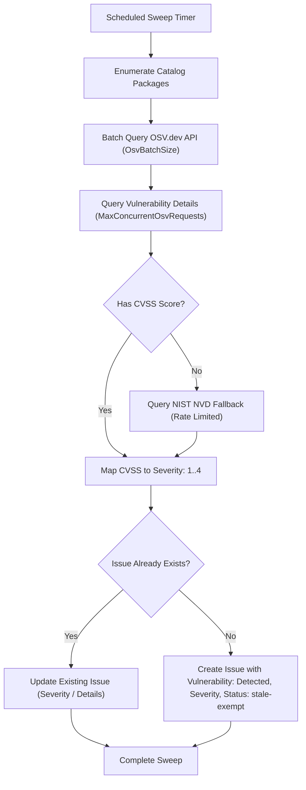

# Active CVE Vulnerability Watch Service

Autonomous background worker that periodically scans distribution package specifications against OSV.dev and NIST NVD CVE 2.0 to file and reconcile security tracking issues.

---

## 1. Purpose and Trigger Events

Provides proactive vulnerability monitoring for authoritative-ecosystem package specifications (`crates.io`, `PyPI`) by default, with optional best-effort scanning for native RPM packages. Operates as an independent scheduled background service (`IHostedService`).

### Trigger Mechanism
- Periodic background timer configured by `CheckIntervalHours` (default: every 24 hours).
- Does not rely on incoming webhook events.

---

## 2. Evaluation Logic and Workflow



### Key Functional Behaviors
1. **O(1) Tarball Catalog & Slice-Before-Fetch Fallback**: `GitHubSpecCatalog` loads all `SPECS/*/*.spec` definitions from a single repository tarball download (`GetArchive`, buffered in memory and then checked against `PackageUpdate:MaxArchiveBytes` before tar parsing, cached for 6 hours). If archive download fails or the buffered archive exceeds `MaxArchiveBytes` and the catalog falls back to Git Trees + per-file fetches, `CveActiveWatchService` slices `PackagesPerSweep` sorted package names **before** fetching `.spec` contents so a sweep never triggers O(N) GitHub API requests.
2. **Pre-Sweep Fail-Closed Rate Limit Guard & Unified Issue Identity Index**: Each sweep verifies non-null Core (`>= 500`) and Search (`>= 5`) API remaining quota before scanning (unknown/`null` quotas fail closed and defer the sweep). After OSV scanning completes, the service executes a **single** open-issue search (`label:"<IssueLabel>" is:issue is:open`, up to 500 items), builds an in-memory **package-keyed index** (`<!-- abaci-cve-package: <pkg> -->` marker first, falling back to `[Security] Outstanding CVEs detected in <pkg>` title prefix) used consistently by creation, update (preserving maintainer title annotations), and auto-closure with zero per-finding Search API calls. If that initial Search query fails, the sweep fails closed and defers issue creation/closure to avoid duplicate tracking issues. If the open-issue search result is truncated (`IsTruncated == true`, i.e., `> 500` matching open issues), the sweep still updates and resolves indexed issues safely while deferring **new** issue creation so existing unindexed issues are never duplicated.
3. **Authoritative Ecosystem Gate & Macro Filtering**: `PackageVulnerabilityScanner` extracts `%global crate_name` (`crates.io`), `%global pypi_name`/`srcname`, `python-`/`python3-` prefixes (`PyPI`), and `rust-*` prefixes (deriving upstream crate/PyPI names even when explicit `%global` metadata is absent or macro-templated), normalizes RPM epochs (`1:8.21.0 -> 8.21.0`) and `+suffix` metadata, and skips unresolved macro versions (`%{version}`) or invalid version/upstream strings. When `IncludeUnverifiedNativePackages` is `false` (default), native RPM packages without an authoritative ecosystem are skipped (internal reason `unverified_ecosystem`) rather than issuing ecosystem-less OSV queries, excluded from `SuccessfullyScannedPackages`, and any pre-existing open tracking issue for those packages receives a one-time idempotent migration comment (`<!-- abaci-cve-unverified-notice -->`) without adding unprovisioned labels. When `IncludeUnverifiedNativePackages` is explicitly set to `true`, non-macro native RPMs are queried best-effort without an ecosystem and generated issues display a top-of-body `Best-Effort / Unverified Ecosystem` warning banner.
4. **OSV Batch Ingestion & Bounded Detail Cap**: Queries OSV.dev batch API using chunks up to `OsvBatchSize` (default: 1000) and resolves at most **20** unique canonical CVE/GHSA details per package per sweep, reporting total count in truncation notices.
5. **NVD Fallback Throttling**: When OSV records lack CVSS score metrics, falls back to NIST NVD CVE 2.0 API subject to daily quota (`MaxNvdQueriesPerDay`) and serialized delay (`NvdRequestDelayMilliseconds` = 6500 ms) to avoid HTTP 429 rate limits.
6. **Issue Lifecycle Management & Authoritative Auto-Close**: Automatically files GitHub tracking issues containing CVE identifiers, CVSS scores, package names, and the embedded `<!-- abaci-cve-package: <pkg> -->` identity marker. Only packages with authoritative ecosystems, valid versions, and clean/resolved query responses enter `SuccessfullyScannedPackages` to auto-close resolved issues (removing `IssueLabel` and adding `Vulnerability: Resolved`).
7. **Protection**: Applies `Status: stale-exempt` to prevent `StaleLifecycleService` from auto-closing unresolved security tracking issues.

---

## 3. Managed Labels and Mutex Group

- `Vulnerability: Detected`: Base label applied to active CVE tracking issues.
- `Severity: 1`, `Severity: 2`, `Severity: 3`, `Severity: 4`: CVSS severity tier assigned based on the highest CVSS v3.1/v4.0 score. When no valid score is available from OSV or NVD, no severity label is attached.
- `Status: stale-exempt`: Applied to tracking issues to protect them from automated stale sweeps.

---

## 4. Configuration Options

Configured under the `CveActiveWatch` JSON section in `appsettings.json`:

| Parameter | Type | Default | Description |
|---|---|---|---|
| `Enabled` | `bool` | `false` | Master toggle for the proactive CVE watch service. |
| `DryRun` | `bool` | `true` | When `true`, scans packages and logs findings without creating or updating issues. |
| `TargetRepository` | `string` | `"openRuyi-Project/openRuyi"` | Repository to scan and track security issues in. |
| `CheckIntervalHours` | `int` | `24` | Interval in hours between full catalog vulnerability sweeps. |
| `OsvBatchSize` | `int` | `1000` | Package batch size per OSV query chunk (API max: 1000). |
| `PackagesPerSweep` | `int` | `0` | Packages to scan per sweep. When 0, scans the full catalog. When non-zero, sweeps advance sequentially through the package catalog across successive cycles. |
| `IncludeUnverifiedNativePackages` | `bool` | `false` | When `false`, native RPM specs lacking an authoritative OSV ecosystem (`crates.io` / `PyPI`) are skipped (internal reason `unverified_ecosystem`). When `true`, non-macro native RPMs are queried best-effort without an ecosystem and flagged with a warning banner. |
| `MaxNvdQueriesPerDay` | `int` | `200` | Daily request cap for NIST NVD fallback queries. |
| `NvdRequestDelayMilliseconds` | `int` | `6500` | Serialized inter-request throttle delay for unauthenticated NVD queries. |
| `MaxConcurrentOsvRequests` | `int` | `8` | Maximum concurrent HTTP requests dispatched when resolving OSV vulnerability details. |
| `IssueLabel` | `string` | `"Vulnerability: Detected"` | Primary label applied to security tracking issues. |
| `CacheExpirationHours` | `int` | `168` | Cache duration in hours for package vulnerability lookup results. |

---

## 5. Failure Handling and Fallback Semantics

- **Search Quota Conservation, Truncation Guard & Fail-Closed Index Lookup**: Deferring when `SearchRemaining < 5` and querying open `IssueLabel` issues once per sweep prevents per-finding GitHub Search API rate-limit exhaustion and downstream package starvation; if the pre-sweep open-issue Search query fails, issue creation and auto-closure abort cleanly without creating duplicate issues, and if the search index is truncated (`> 500` open issues), new issue creation is deferred fail-closed while existing indexed issues continue to be updated and resolved.
- **Source Resilience**: OSV query failures are logged and do not crash the sweep. NVD queries back off and fail gracefully if HTTP 429 or network timeouts occur.
- **Fail-Safe Issue Tracking**: If CVE severity cannot be determined from either OSV or NVD, issues are created with base tracking label `Vulnerability: Detected` without crashing.
- **Migrating Legacy Native RPM Tracking Issues**: Pre-existing open issues created for plain native RPM packages before the authoritative ecosystem gate (such as earlier unverified native filings) carry `Status: stale-exempt` and will not auto-close while `IncludeUnverifiedNativePackages` is `false`. On the first sweep touching those packages in live mode (`DryRun=false`), `abaci-bot` posts a one-time `<!-- abaci-cve-unverified-notice -->` comment explaining how to triage or opt into best-effort tracking. Maintainers can review and clean up remaining open issues with:
  ```bash
  gh issue list --repo openRuyi-Project/openRuyi --label "Vulnerability: Detected" --state open
  ```

---

## 6. Minimal Configuration Example

```json
{
  "CveActiveWatch": {
    "Enabled": true,
    "DryRun": false,
    "TargetRepository": "openRuyi-Project/openRuyi",
    "CheckIntervalHours": 24
  }
}
```
