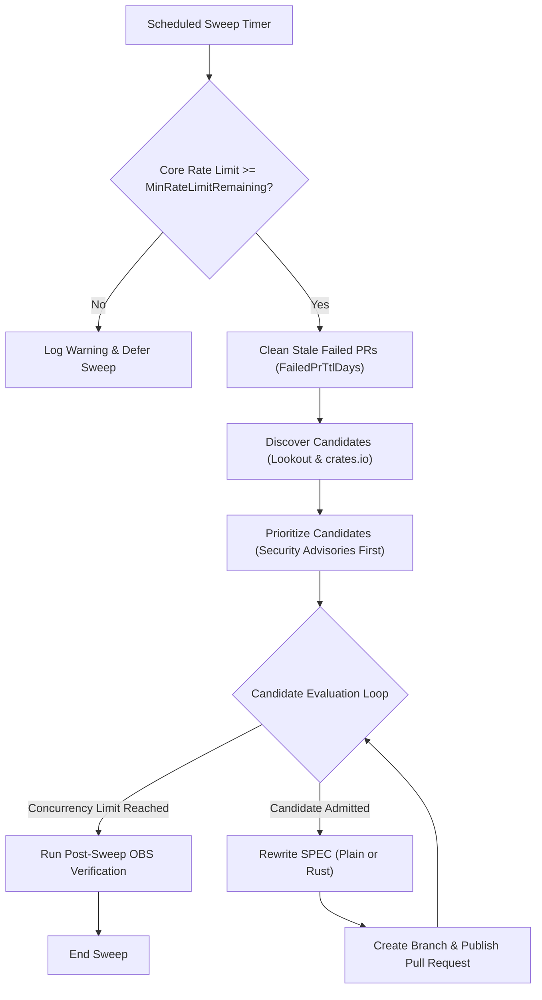

# Package Update Service

Autonomous background worker that periodically polls upstream package releases, evaluates upgrade admission criteria, updates RPM SPEC files, backfills continuous integration checksums, and publishes automated pull requests.

---

## 1. Purpose and Trigger Events

Automates the routine discovery, preparation, and publication of upstream package upgrades for RPM specifications in package repositories. Operates as an independent scheduled background service (`IHostedService`).

### Trigger Mechanism & Permission Prerequisites
- Periodic background timer configured by `CheckIntervalHours` (default: every 12 hours).
- Does not rely on incoming webhook events.
- **Required Permissions (`PackageUpdate:Enabled=true && DryRun=false`):** Requires **`Repository -> Contents: Read and write`** (in addition to `Pull requests: Read and write`, `Issues: Read and write`, `Actions: Read-only`, `Metadata: Read-only`, and `Organization -> Members: Read-only` on the GitHub App). When `PackageUpdate:BotPat` is configured, all API calls switch globally to that PAT, which must also carry `Contents: write`, `Issues: write`, `Pull requests: write`, `Actions: read`, `Organization Members: read` (`read:org`), and `push+` repository access (required whenever `PackageUpdate` runs live with `DryRun=false` or `ConversationGuard:Enabled=true`). `PackageUpdatePermissionProbe` verifies all four GitHub App repository permissions (`Contents`, `Pull requests`, `Issues`, `Actions`) or PAT `push+` + read-only `Actions` access when `PackageUpdate` runs live, and when `BotPat` is set verifies organization team-read once per unique organization across active module repositories (falling back to `PackageUpdate:TargetRepository` even when optional modules are disabled; note GitHub REST provides no non-mutating write-scope introspection for fine-grained PAT `Contents`/`Issues`/`Pull requests` grants), surfacing `capabilities.packageUpdatePermission` under `/health?verbose=true`.

---

## 2. Evaluation Logic and Workflow



### Key Functional Behaviors
1. **O(1) Streaming Tarball Spec Catalog, Slice-Before-Fetch & Two-Phase Repo-Scoped Cursor**: `GitHubSpecCatalog` streams the repository tarball snapshot once per 6-hour refresh window (`OpenRepositoryTarballStreamAsync` using `HttpCompletionOption.ResponseHeadersRead`, rejecting oversized `Content-Length` headers with zero body bytes read and enforcing `MaxArchiveBytes` defaults of `104857600` bytes / 100 MiB mid-stream via `BoundedReadStream` before decompressing through `GZipStream -> TarReader` with `4 MiB` per-spec and `256 MiB` cumulative decompressed `.spec` caps) and extracts only `SPECS/*/*.spec` entries into memory, avoiding O(N) per-file GitHub API requests across thousands of packages. When falling back to lazy tree lookup (if the archive download fails or exceeds compressed or decompressed size caps), `RustCrateVersionSource` filters and slices `MaxCratesPerSweep` sorted `rust-*` package names **before** fetching `.spec` contents, resuming across restarts from a durable lexicographical package-name watermark persisted in `BotState:StateDirectory/bot-state.json` under a repository-scoped key (`rust-crates:<owner>/<repo>`). The watermark is staged in memory during discovery and committed on disk **only after** scheduler completion in `CompleteSweep` when `DryRun=false` (advancing past 2xx/404/non-crate specs and freezing prior to transient 5xx/network errors) with per-source fault isolation, so `DryRun` runs or interrupted/crashed live sweeps never skip unconfirmed slices.
2. **Cross-Source Fair Scheduling (`CandidateScheduler`) & Throughput Bounds**: Candidates across sources (`Lookout`, `RustCrates`) are scheduled in two tiers—security advisories first, then routine updates grouped by `CandidateOrigin` (oldest `PublishedAt` first inside each bucket)—using round-robin rotation that advances its turn only when a source **actually publishes** a pull request (skipped candidates never waste a slot or starve another source, and the starting origin rotates across consecutive live sweeps, persisted as `candidate-scheduler-origin:<owner>/<repo>` under `BotState:StateDirectory/bot-state.json` `Cursors` only when `DryRun=false`). Security advisories are capped at `MaxCandidatesPerSweep - 1` whenever routine candidates exist, reserving at least one routine slot so security advisories cannot consume the entire sweep; when the cap is `1`, the security and routine tiers alternate across sweeps. When the scheduler defers a discovered Rust candidate due to sweep quota or concurrency capacity limits (absent from both `ProcessedPackageNames` and `FailedPackageNames`), `RustCrateVersionSource` rewinds its durable cursor before that candidate **without penalty**; only attempted candidates whose publish throws an execution error (`FailedPackageNames`) accrue the bounded 3 consecutive rewind limit before deliberately advancing past persistent poison failures so unpublishable specs or repeated label/base failures cannot permanently wedge the Rust cursor. Sources that yield zero candidates in a non-disabled sweep explicitly reset their sweep counters (`lastPublishedCount=0`, `lastSkippedCount=0`, `oldestCandidatePublishedAt=null`) in `/health?verbose=true`. Effective publishing volume per sweep is bounded by `Min(MaxCandidatesPerSweep, MaxConcurrentPullRequests - activeOpenPrs)`; at the default cadence (`5` candidates per `12` hours), draining a backlog of ~2,000 outdated candidates takes roughly 200 days while rotating fairly across both sources.
3. **Admission Rules & Author-First Human Edit Protection**: Extracts the authoritative current version directly from the `main` branch SPEC (`UpdateAdmission.TryExtractCurrentVersion`) for both cross-major checks and PR titles/descriptions so stale external discovery metadata cannot mislabel a PR or trigger false major-boundary skips. Prevents accidental cross-major epoch, SemVer, CalVer (`20260526 -> 20260817`, `202602 -> 202608`, `2026c -> 2026d`; note cross-year CalVer jumps such as `2026f -> 2027a` intentionally evaluate as cross-major and fail closed when `AllowCrossMajorVersion = false`), underscore/dot numeric (`3_508 -> 3_509`), and delimited alpha-major (`B.02.20 -> B.02.21`) breaking changes (`AllowCrossMajorVersion = false`, comparing RPM epochs first before structured major tokens and failing closed whenever token kinds differ or either version is opaque such as `snapshot20240101` and the stripped versions differ) and skips packages containing downstream `Patch` directives (`SkipPackagesWithPatches = true`). Both existing-branch updates and new-branch creations re-verify and re-rewrite against live `main` SPEC at pinned live `baseSha` (defaulting to `[PlainSpecVersionRewriter, RustCrateSpecRewriter]` and failing closed if `_specRewriters` is explicitly empty; enforcing `#!NoAutoUpdate`, target version, `Patch` directives, and cross-major policy, and failing closed if live base SPEC is empty/missing or if an existing branch tip SHA moves concurrently before commit) so stale tarball caches never revert recent base edits; if an orphan `autoupdate/<pkg>` branch is already at the target version without an open PR, the publisher preserves existing `#!RemoteAsset` directive lines when live `main` has zero non-`#!RemoteAsset` drift and otherwise updates the branch commit before creating the PR, while manually closing an automated PR without opting out (`@<bot> ignore <pkg>` or `#!NoAutoUpdate: <reason>`) leaves future sweeps eligible to recreate the PR. Across publishing, OBS post-merge verification, and failed-PR cleanup/backfill, `BotCommitOwnership` requires live bot identity whenever `IBotIdentityProvider` is wired (failing closed on live identity outage instead of falling back to configured `BotLogin`, falling back to `BotLogin` only when no live provider is configured). Before pushing to an existing `autoupdate/<pkg>` branch, `GitHubPackageUpdatePublisher` verifies `BranchCommitInfo.AuthorLogin` strictly matches the bot itself while `CommitterLogin` (if present) matches the bot or GitHub's `web-flow` server signature; human edits via the GitHub Web UI (`Author=<maintainer>`, `Committer=web-flow`), external `[bot]` actors, empty identities, and local human amends cause the bot to step aside cleanly and deduplicate its notice per `(branch, targetVersion)`. The same shared two-tier ownership rules guard `PackageUpdateService` failed-PR cleanup/backfill (Tier 1 loop entry requires `IsOwnBotLogin(prAuthor) && isSameRepo` so fork PRs or human PRs carrying `Auto-Update` never trigger `ListWorkflowRunsAsync`, slot counting, backfill, or closes; Tier 2 further validates `BranchPrefix`, `latestCommit.Sha == headSha`, and `IsOwnBotCommit`), prefix-based PR self-healing (ignoring human-authored PRs sharing `autoupdate/`), and OBS post-merge verification (requiring `ownBotLogins` non-empty and rejecting null/non-bot `pr.User?.Login`).
4. **Spec Version Rewriters & Guaranteed Labeling**:
   - `PlainSpecVersionRewriter`: Updates a unique `Version:` token (validating with `UpdateAdmission.IsValidTargetVersion` and failing closed on missing or duplicate `Version:` lines) while keeping `Release:` intact.
   - `RustCrateSpecRewriter`: Synchronizes unique non-macro `Version:` and `%global full_version` tokens for Rust crates (matching indented or unindented `%global full_version` consistently with `UpdateAdmission`); `RustCrateVersionSource.SelectLatestVersion` unifies version ranking via `UpdateAdmission.CompareRpmVersions` after `IsValidTargetVersion` filtering so non-semver metadata tags cannot downgrade valid releases.
   - Sweeps verify required repository labels before publishing candidates (`EnsureRequiredLabelsVerifiedAsync`, failing closed if missing labels cannot be created), apply the full required label union (`Auto-Update`, `Status: stale-exempt`, and `Auto-Update: Rust` when applicable) to both new and updated PRs with retry, fail publishing if labeling fails, and supplement open PR inventory via `IOpenPullRequestInventoryGateway` (`ListOpenPullRequestsByHeadPrefixAsync`, auto-healing missing labels only on bot-authored open PRs).
5. **CI Checksum Backfill & Stepped-Aside Comment Dedup**: Detects failed pull requests caused by invalid `#!RemoteAsset` checksums, strictly validates diff paths against `SPECS/<pkg>/<file>.spec` without traversal, and applies single-line exact `#!RemoteAsset` digest replacement rather than global string replacement.
6. **Orthogonal Cooldowns, Failure Decay, Bounded Failed-PR Concurrency & Pre-Gate**: Before evaluating candidates, each sweep queries open `Auto-Update: Blocked` tracking issues and open `Auto-Update` / bot-authored branch-prefix PRs so blocked packages are skipped deterministically across restarts (and failed PR deduplication is persisted via `bot-state.json`). `PackageFailureEntry` tracks CI failures (`ConsecutiveFailures`, `CooldownUntil`, `LastFailureAt`) and OBS post-merge blocks (`ObsBlockedUntil`) orthogonally, and `PackageUpdateService.IsInCooldown` reads `IBotStateStore` directly as its single source of truth so clearing `ObsBlockedUntil` unblocks candidates immediately without suppressing CI failure tracking (`RecordFailure` gates on CI cooldown only). `PackageFailureEntry.LastFailureAt` decays old consecutive CI failure counts automatically after `GiveUpIssueCooldownDays` days (default 30). To avoid single-package CI failures stalling the queue without risking PR floods during a global outage, active failing PRs occupy at most `MaxConcurrentPullRequests - 1` concurrency slots (preserving at least one active slot) subject to an overall hard cap of `MaxConcurrentPullRequests * 2` total open bot PRs. `DryRun` mode never records `PackageFailure`, failed-PR deduplication entries, scheduler offsets, or source sweep cursors into `bot-state.json`.
7. **Post-Merge OBS Verification Closed Loop**: `ObsPostMergeVerifier` runs in a guaranteed post-sweep `finally` block (isolated from individual candidate publish exceptions) and polls Open Build Service (`build.openruyi.cn`) to verify bot-authored merged pull request commits (`SearchMergedPullRequestsAsync` paginates up to 300 PRs over a clamped `Math.Clamp(FailedPrTtlDays + 2, 7, 365)`-day lookback window with per-PR error isolation and bounded warning deduplication for non-SHA `_service` revisions). Revision checks match exact commits or unambiguous commit SHA prefixes (`>= 7` hex chars); non-SHA tag/branch revisions emit one warning per revision key without guessing attribution. Beyond `_service` revision matching, terminal OBS results reject `dirty` `_result` entries and split freshness validation across two paths: job-backed states (`Succeeded`, `Failed`) verify `/public/source` `_service` readiness (`serviceinfo/@xsrcmd5`) plus `/public/build/.../_jobhistory` `srcmd5` parity, `LatestJobCode == Code`, and `starttime >= mergedAt - 2m`, whereas pre-job failure states (`Unresolvable`, `Broken`)—where OBS never dispatches a build job—verify source completion (or `serviceinfo/@code="failed"` for `Broken`), absence of conflicting pre-merge `_jobhistory` jobs matching `SourceMd5`, and `LatestSourceMtime >= mergedAt - 2m`, deferring stale/unconfirmed failure results safely without prematurely flagging merged PRs or closing issues. When `RequireObsSuccessAfterMerge` is enabled and OBS reports a fresh verified `Failed`, `Unresolvable`, or `Broken` result, it applies `Auto-Update: Blocked` to the merged PR **and** idempotently creates an open tracking issue (`[Auto-Update: Blocked] Post-merge OBS build failure on package <pkg>`, clearing any prior fallback `ObsBlockedUntil` once the issue exists; deferring new creation fail-closed when the blocked index is truncated past 500 items and recording an orthogonal `ObsBlockedUntil` fallback cooldown of `GiveUpIssueCooldownDays` days if issue creation fails); open OBS tracking issues are also re-evaluated on every sweep independent of the lookback PR window and closed automatically—clearing `ObsBlockedUntil` only when no open tracking issue existed or the open issue was successfully closed, and safely reclaiming merged branches from `PR #<N>`—if `main` upgrades past the failing version or OBS produces a fresh verified `Succeeded` build. When Lookout omits upstream `published_at`, initial observation uses `DateTimeOffset.UtcNow` rather than Lookout's older monitor `updated_at`, and stale `firstSeen` entries are pruned only after clean full sweeps where Lookout returned `> 0` packages (`LookoutVersionSource` checks explicit `pages`/`total` pagination metadata first so server-clamped `per_page` values still walk every page, treats contradictory `total = 0` with non-empty items as incomplete so `firstSeen` is never pruned, falls back to `items.Count < perPage` when omitted, and marks source health `"degraded"` without pruning `firstSeen` if the `maxPages = 50` truncation cap is reached).

---

## 3. Managed Labels and Mutex Group

- `Auto-Update`: Base label applied to all pull requests published by the package update service.
- `Auto-Update: Rust`: Applied to pull requests updating Rust Cargo crates.
- `Auto-Update: Blocked`: Applied to tracking issues when repeated failures occur or to merged PRs failing post-merge OBS verification. Any package with an open `Auto-Update: Blocked` tracking issue or open PR is skipped by the sweep pre-gate until the tracking issue is closed (or the label is removed), even after process restarts.
- `Status: stale-exempt`: Applied to tracking issues and pull requests so automated stale sweeps do not close them.

---

## 4. Configuration Options

Configured under the `PackageUpdate` JSON section in `appsettings.json`:

| Parameter | Type | Default | Description |
|---|---|---|---|
| `Enabled` | `bool` | `false` | Master toggle for the package update background service. |
| `DryRun` | `bool` | `true` | When `true`, discovers candidates and rewrites specs in memory without pushing branches, opening PRs, or creating labels on GitHub. |
| `TargetRepository` | `string` | `"openRuyi-Project/openRuyi"` | Target repository to publish pull requests against in `"owner/repo"` format. |
| `BotLogin` | `string` | `"aqua-rium"` | GitHub login used to author automated update pull requests. |
| `BotPat` | `string` | `""` | Optional GitHub Personal Access Token; switches **all** API requests globally to the PAT user when set (must hold `Contents/Issues/Pull requests` write, `Actions` read, `read:org`/Org `Members` read, plus `push+` if `ConversationGuard:Enabled=true`). When empty, uses GitHub App installation auth (`Contents: Read and write` required when `Enabled=true && DryRun=false`). |
| `BranchPrefix` | `string` | `"autoupdate/"` | Prefix prepended to generated git branches. |
| `CheckIntervalHours` | `int` | `12` | Frequency in hours between candidate discovery sweeps. |
| `Lookout` | `LookoutUpdateOptions` | (object) | Configuration for the Lookout upstream candidate discovery service (`lookout.openruyi.cn`). |
| `RustCratePoller` | `RustCratePollerOptions` | (object) | Configuration for the crates.io sparse index poller. |
| `Obs` | `ObsOptions` | (object) | Configuration for post-merge Open Build Service build verification. |
| `AllowCrossMajorVersion` | `bool` | `false` | Whether to permit updates crossing major version boundaries (when `false`, unparseable major versions with differing tokens also fail closed). |
| `SkipPackagesWithPatches` | `bool` | `true` | When `true`, packages with downstream `Patch` directives are skipped. |
| `MaxCandidatesPerSweep` | `int` | `5` | Maximum number of update candidates admitted and published in a single sweep. |
| `MaxConcurrentPullRequests` | `int` | `5` | Maximum open update pull requests allowed simultaneously. |
| `FailedPrTtlDays` | `int` | `7` | Days (`1..363`) an inactive pull request with failing CI remains open before automated closure, and maximum age of merged pull requests before unverified branches are reclaimed (bounded at `363` so OBS lookback `Math.Clamp(FailedPrTtlDays + 2, 7, 365)` never overflows 1 year). |
| `CooldownHours` | `int` | `72` | Minimum age in hours an upstream release (or persisted first observation when Lookout omits `published_at`) must reach before submission. Setting 0 disables the stabilization window. Security advisories bypass this stabilization delay. |
| `MaxConsecutiveFailures` | `int` | `3` | Consecutive failed pull requests before entering cooldown. |
| `IssueOnGivingUp` | `bool` | `true` | Whether to file a tracking issue when a package reaches consecutive failure limits. |
| `GiveUpIssueCooldownDays` | `int` | `30` | Shared recovery horizon in days governing CI give-up cooldown, `LastFailureAt` consecutive-failure decay window, and fallback `ObsBlockedUntil` cooldown if tracking-issue creation fails. |
| `GiveUpIssueLabel` | `string` | `"Status: stale-exempt"` | Protection label applied to failure tracking issues. |
| `MinRateLimitRemaining` | `int` | `500` | Minimum core GitHub API quota required to begin a sweep. |
| `RequestThrottleMilliseconds` | `int` | `2000` | Delay in milliseconds inserted after publishing each update pull request to prevent secondary rate limits. |
| `MaxArchiveBytes` | `long` | `104857600` | Maximum compressed repository tarball size in bytes (100 MiB) accepted via HTTP `Content-Length` pre-check and `BoundedReadStream` streaming read before falling back to Git Tree API (`0` disables the compressed archive cap; individual and cumulative decompressed `.spec` entries remain capped at 4 MiB per spec and 256 MiB total). |

### Nested Options

#### `LookoutUpdateOptions` (`PackageUpdate:Lookout`)
- `Enabled` (`bool`, default: `true`): Toggles Lookout candidate source.
- `BaseUrl` (`string`, default: `"https://lookout.openruyi.cn"`): Base endpoint URL for Lookout API.
- `StaleThresholdHours` (`int`, default: `48`): Freshness threshold in hours for Lookout candidate observations.
- `FirstSeenStatePath` (`string`, default: `""`): Optional path to the JSON file persisting first-observed timestamps for `(package, target_version)` pairs across process restarts when Lookout omits `published_at`. When empty, defaults to `lookout-first-seen.json` under `IBotStateStore.StateDirectory` (`BotState:StateDirectory`, `/state` in Docker Compose, or the local application data directory when unset).

#### `RustCratePollerOptions` (`PackageUpdate:RustCratePoller`)
- `Enabled` (`bool`, default: `true`): Toggles crates.io candidate poller.
- `IndexBaseUrl` (`string`, default: `"https://index.crates.io"`): Base URL for crates.io sparse index.
- `MaxCratesPerSweep` (`int`, default: `60`): Maximum crate versions queried per sweep.
- `RequestDelayMilliseconds` (`int`, default: `300`): Inter-query throttle delay for crates.io queries.

#### `ObsOptions` (`PackageUpdate:Obs`)
- `BaseUrl` (`string`, default: `"https://build.openruyi.cn"`): OBS public API endpoint.
- `Project` (`string`, default: `"openruyi"`): Target OBS project name.
- `TargetRepository` (`string`, default: `"riscv64"`): Target OBS repository name.
- `TargetArch` (`string`, default: `"riscv64"`): Target OBS architecture filter.
- `RequireObsSuccessAfterMerge` (`bool`, default: `false`): Applies `Auto-Update: Blocked` on the merged PR and creates a blocking open tracking issue (automatically closed if OBS later succeeds; falls back to an orthogonal `ObsBlockedUntil` cooldown of `GiveUpIssueCooldownDays` if issue creation fails) when post-merge OBS build returns `Failed`, `Unresolvable`, or `Broken`.

---

## 5. Failure Handling and Fallback Semantics

- **Quota Starvation**: Sweeps defer automatically when remaining GitHub API quota drops below `MinRateLimitRemaining`.
- **Optimistic Concurrency (CAS) Spec Commits & Backfills**: SPEC writes from `GitHubPackageUpdatePublisher` and `#!RemoteAsset` checksum backfills from `RemoteAssetBackfiller` use `IOptimisticFileContentGateway` (`GetFileContentWithShaAsync` + `UpdateFileContentIfUnchangedAsync`) to pass the authoritative Git blob SHA (`expectedBlobSha`) directly into GitHub's `PUT /contents` API without re-fetching inside the write helper, failing closed on HTTP `409 Conflict` / `422 UnprocessableEntity` instead of overwriting concurrent human or CI commits.
- **Persistent Crates.io Cursor & Poison-Pill Rewind**: `RustCrateVersionSource` persists both its sweep cursor watermark and its consecutive publish-failure rewind counter (`rust-crates-poison`) in `IBotStateStore` (`bot-state.json`) whenever `DryRun == false`, surviving process restarts without starving subsequent crates or resetting poison-pill limits.
- **Permission Probe Capability Fidelity**: `PackageUpdatePermissionProbe` reports `"verified"` on `/health?verbose=true` for GitHub App installations and classic PATs (`X-OAuth-Scopes` verified alongside `Actions: Read-only`), and logs a warning while permitting live startup with `"partial"` status for fine-grained PATs after passing `push+` plus four zero-side-effect read probes (`Actions`, `Pull requests`, `Issues`, `Contents`), because GitHub REST offers no non-mutating write-scope introspection endpoint for fine-grained PATs (prefer GitHub App auth or classic PAT for full write-scope startup guarantees).
- **Source Health & Per-Source Metrics**: `LookoutVersionSource` and `RustCrateVersionSource` record structured status (`healthy`, `degraded`, `failed`, `disabled`), `lastSuccessAt`, `consecutiveFailures`, and sanitized `lastError` into `RuntimeHealthState`, enriched per sweep with `lastPublishedCount`, `lastSkippedCount`, and `oldestCandidatePublishedAt` under `GET /health?verbose=true` (`sources`). Complete sweep outages also emit `LogError` while leaving default `GET /health` liveness at HTTP 200.
- **Per-Candidate Fault Isolation**: Each candidate publish runs inside an isolated exception handler so one transient HTTP 422/rate-limit/network error logs `LogError` and advances to the remaining candidates, and post-merge OBS verification always executes in a `finally` block unless cancelled.
- **Fail-Closed Gate Loading**: If querying open `Auto-Update: Blocked` tracking issues or enumerating open `Auto-Update` pull requests fails due to GitHub API or search errors, candidate discovery and PR publishing are deferred until the next sweep so blocked packages cannot slip through and concurrency caps are never exceeded. Post-merge OBS checks still execute.
- **Merge Commit Synchronization**: OBS verification checks `_service` revision against the PR's `MergeCommitSha` to avoid checking stale build results before synchronization completes.
- **Fail-Safe Dry Run**: Starts in `DryRun = true` and `Enabled = false` by default (`DryRun` suppresses GitHub writes and never records CI failure cooldowns, scheduler offsets, or source sweep cursors into `bot-state.json`).
- **Runtime Control Plane & Localization (`BotControlPlaneModule`, Priority 96)**:
  - `@<bot> ignore <package> [reason]` / `@<bot> unignore <package>` (maintainers with `triage`+): persists runtime package ignores in `BotState:StateDirectory/bot-state.json` alongside persistent failure cooldowns.
  - `@<bot> status [package]`: inspects runtime ignore state, `#!NoAutoUpdate` in the spec file, CI failure cooldown, OBS post-merge fallback cooldown (`ObsBlockedUntil`), and any open `Auto-Update: Blocked` tracking issue.
  - `@<bot> lang <en|zh|reset>`: sets or clears the caller's personal reply language preference unless the repository sets `BotState:RepositoryForcedLocales`. Direct command replies use the caller's preference, while PR governance reviews use the PR author's preference (`RepositoryForcedLocales -> User Preference -> RepositoryDefaultLocales -> DefaultLocale`). Autonomous bot pull requests use `RepositoryForcedLocales -> RepositoryDefaultLocales -> DefaultLocale` without mixed-language text. See [bot-control-plane.md](bot-control-plane.md).
- **Security Updates Concurrency & Bypass**: Security advisories bypass the `CooldownHours` release stabilization window and receive a dedicated 5-slot **open PR concurrency allowance** above `MaxConcurrentPullRequests` so routine open PRs do not block security updates; total PRs published in a single sweep remains bounded by the orthogonal `MaxCandidatesPerSweep` burst cap.
- **Closed-Loop Cooldown Reset**: When a package enters failure cooldown due to consecutive CI failures (`MaxConsecutiveFailures`), cooldown is deterministically reset via two authoritative events:
  1. The tracking issue opened on GitHub is closed by maintainers.
  2. The SPEC file on `main` is manually updated to or past the target version.
  Unstructured issue comments do not unfreeze cooldown to avoid false resets during discussion. If maintainers need to manually unfreeze a package early, simply close the tracking issue or bump the SPEC on main.
- **Merged Branch Reclamation**: Git branches created for pull requests (`autoupdate/<pkg>`) are safely deleted after PR merge once:
  1. Post-merge OBS build verification reports `Succeeded` (including delayed recovery beyond the merged PR lookback window when `ReconcileOpenObsBlockedIssuesAsync` resolves the blocking issue referencing `PR #N`), or
  2. The merged PR has aged past `FailedPrTtlDays` (preventing branch accumulation for broken OBS builds).
  Branch deletion enforces strict `AND` ownership across all sweep and blocked-issue reconciliation paths: `IsOwnBotLogin(pr.User?.Login)` (failing closed when null/empty), target repository match, `BranchPrefix` match, no active open PR reusing the branch, current ref SHA equal to `pr.Head.Sha`, and `GetBranchLatestCommitAsync` confirming `latestCommit.Sha == pr.Head.Sha && BotCommitOwnership.IsOwnBotCommit` (so bot PRs with subsequent human commits are preserved).

---

## 6. Minimal Configuration Example

```json
{
  "PackageUpdate": {
    "Enabled": true,
    "DryRun": false,
    "TargetRepository": "openRuyi-Project/openRuyi",
    "CheckIntervalHours": 12,
    "MaxCandidatesPerSweep": 5,
    "MaxConcurrentPullRequests": 5
  }
}
```
